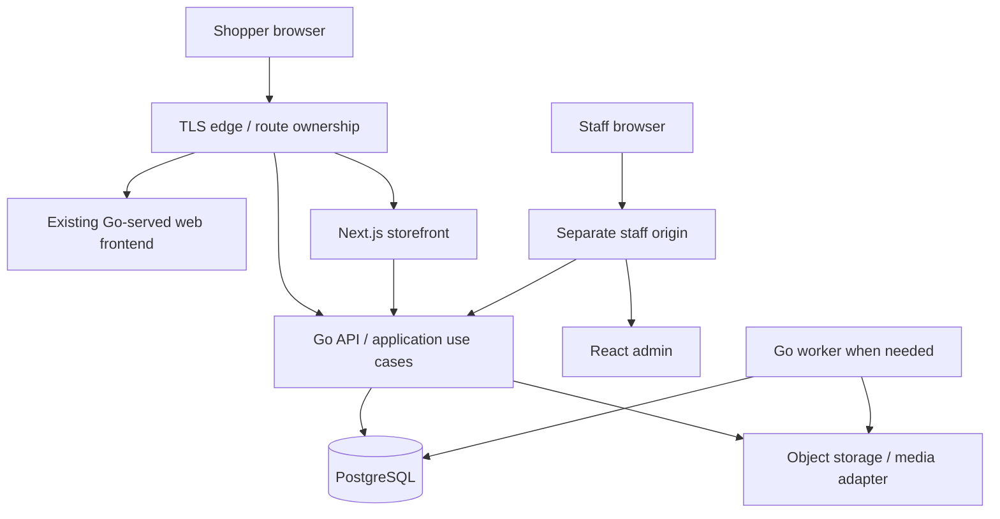

# ADR 001: Preserve the Go commerce core and evolve a modular monolith

Status: Proposed. Date: 2026-09-25. Baseline: `7be70d7`.

## Context

The existing domain/application/repository/HTTP boundaries support working catalog, customer lists, checkout and repeat-order behavior. PostgreSQL already provides constraints, search indexes and transactional stock protection. Frontend complexity and missing operational capabilities are the larger obstacles; there is no evidence requiring backend replacement or microservices.

## Decision

Retain Go and PostgreSQL as the sole authority for identity, permissions, catalog publication, prices, inventory, cart, favorites and orders. Keep one deployable API initially, with explicit modules for identity, catalog/search, cart, favorites, orders, inventory and administration. Extract narrow application-owned ports from `domain.Repository` as slices change. Keep persistence transactions in repository adapters but move reusable pure money/quantity/issue rules into domain code and orchestration into application use cases.

Introduce a TypeScript/React Next.js storefront for public discovery and interactive purchasing. Build a separate TypeScript/React admin application; a client-rendered build is sufficient for staff screens. Share UI primitives, design tokens and generated API types. Neither frontend can access PostgreSQL directly or implement a second commerce backend.

The edge owns `/api/*`, legacy/static routes and Next routes explicitly. Browser mutations call the same-origin Go API; Next server rendering may call Go using request-scoped credentials, without exposing them to client props. Public content can be cached explicitly; personalized responses must bypass shared caches. A Next route handler, if needed for transport, is a thin adapter with no pricing, auth authority or order logic.

Go owns browser sessions. Add cookie authentication with CSRF protection and server revocation alongside legacy bearer support during transition. Use a separate staff session/audience and host-only cookie at the admin origin; enforce permissions in Go. Staff and shopper tokens must not be interchangeable. Keep tokens hashed at rest. Do not introduce JWTs solely because React is being added.

## API and database implications

- Describe current `/api` contracts in OpenAPI first; add named request/response DTOs at the HTTP boundary. Generated TS types are not runtime validation: validate untrusted input in Go and use runtime parsing at external/client boundaries where useful.
- Preserve old endpoints, fields, codes and mutation semantics while legacy users depend on them. Add endpoints/fields for compatible changes. Use a distinct `/api/v2` contract for changes such as strict repeat confirmation or new list envelopes; do not silently reinterpret old requests.
- Keep monetary values as integer minor units, establish supported bounds and currency invariants before JavaScript arithmetic can exceed safe integers. No floating-point money and no casual migration to decimal strings in existing fields.
- Expand schemas, backfill, validate, switch reads, then remove old fields in a later release. Do not edit already-applied migrations `001`–`004` or run their down scripts as a deployment rollback.
- Separate demo fixtures from production initialization. Add production configuration checks and a migration release command with serialization/checksums. Allow nontransactional concurrent-index steps only through an explicit migration mechanism.
- Add a transactional outbox and durable jobs when imports, media, indexing or integrations require asynchronous work. PostgreSQL is sufficient for initial job storage. Introduce external search/cache/queue infrastructure only after measured need.

## Deployment and operation

Retain independent Go and frontend builds, readiness checks, graceful shutdown and least-privileged runtime users. Add a minimal reverse proxy, explicit liveness/readiness, request/status/latency metrics and correlation IDs. Use separate migration and runtime DB credentials, backups with restore exercises, and pinned supported toolchains selected at implementation time. Dependency versions in this repository are not evidence of current security support; perform a vulnerability/support review before release.

Set explicit cache policies per route and asset type. Use versioned static assets. Keep price/stock refreshed and validate again at checkout regardless of public caching. Record route ownership, migration status, error rates, slow queries and rollback triggers. Avoid adding a cache layer until measurements show it is needed.

## Alternatives and consequences

Rejected: a Go rewrite, microservices for each entity, direct database access from Next.js, and a big-bang frontend replacement. All increase migration risk without resolving a demonstrated infrastructure limit. A React-only storefront would simplify hosting but leave public page rendering/metadata work to be built separately. Next.js adds a Node runtime and cache/security responsibilities; accept this cost for public commerce pages while keeping client boundaries narrow. [Next.js documents this server/client rendering split](https://nextjs.org/docs/app/getting-started/server-and-client-components).

The architecture preserves proven transactions but requires careful dual-client compatibility. Shared UI packages must stay small; a generic admin component library must not dictate the storefront design.

## Adoption and acceptance

Adopt in the [phases](../migration-plan.md), without reorganizing the entire Go tree as a prerequisite. Go remains able to serve the legacy app independently. Both frontends pass the same contract and PostgreSQL integration scenarios; no frontend writes directly to the DB; request credentials cannot leak through cache, logs or serialization. Architecture adoption is incomplete until rollback to a compatible legacy frontend has been rehearsed.
