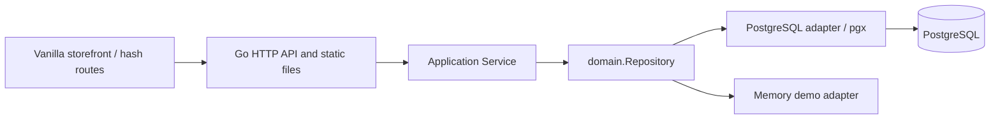

# Repository audit

Date: 2026-09-25. Baseline: `7be70d7`. Scope: architecture and production readiness; no migration implementation.

## Coverage and evidence

Reviewed all 39 tracked files: all Go implementation and test files, eight migration files, all HTML/CSS/JavaScript, README, dependency files, build/container configuration, and four WebP assets. Inspected the local environment configuration without reproducing secret values. `.agents/` and `.codex/` are empty; no applicable `AGENTS.md` was found. Git internals were not treated as application source.

| Files reviewed | Responsibility and notable evidence |
| --- | --- |
| `cmd/server/main.go` | Composition root, environment configuration, pgx pool, startup migrations, memory fallback, HTTP timeouts, shutdown |
| `internal/domain/{models,repository,errors}.go` | Entities, integer minor-unit money, delivery calculation, broad repository port, typed errors |
| `internal/application/service.go` | Authentication, validation, catalog normalization, cart use cases, repeat preview and commit |
| `internal/application/{service,repeat}_test.go` | Business scenarios and repeat quantity arithmetic |
| `internal/delivery/httpapi/{server,server_test}.go` | Routes, bearer auth, filter parsing, JSON contracts, security headers, static frontend, HTTP tests |
| `internal/repository/postgres/{store,cart,orders,migrate}.go` | SQL queries, transaction boundaries, batch operations, migration runner |
| `internal/repository/postgres/store_test.go` | Two SQL construction tests; no database connection |
| `internal/repository/memory/store.go` | Mutex-protected demo adapter, independent fixture and calculation implementation |
| `migrations/001_*` | Schema, constraints, generated search vector and indexes |
| `migrations/002_*` | Demo account/catalog/cart/favorites/order; destructive demo rollback |
| `migrations/003_*` | Trigram, SKU, sorting and collection indexes |
| `migrations/004_*` | Deferred composite brand/manufacturer FK; removes unsafe default brand assignment |
| `web/app.js` | 1,710-line IIFE: demo fixtures, API client, registry, routing, rendering, state, forms, event delegation |
| `web/index.html`, `web/styles.css` | Static shell, hash links, SVG icons, 666-line responsive global stylesheet |
| `web/assets/*.webp` | Warm neutral photographic assets; hero and three category-level product images, approximately 404 KiB on disk total |
| `README.md`, `Makefile`, `Dockerfile`, `docker-compose.yml`, `.dockerignore`, `.env`, `.env.example`, `go.mod`, `go.sum` | Operation, dependency and configuration contracts; documentation sometimes overstates UI completeness |

Verification: `make check` passed (gofmt check, vet, all tests); `make test-race` passed; `node --check web/app.js` passed. Used Go 1.22.1 and an isolated cache under `/tmp`. There are 16 top-level Go tests, plus repeat arithmetic subtests. The Docker CLI wrapper crashed during `docker compose config --quiet`; invoking the installed Compose plugin directly with `config --quiet` passed.

No PostgreSQL instance was started or modified, and no real-database transaction/migration tests, browser E2E, screen-reader checks, load measurements, or dependency vulnerability scan were performed. SQL, UX and concurrency concerns below are source findings, not claims of reproduced production incidents. Asset appearance was inspected; the rendered application was not visually exercised.

## Current architecture

This is an existing layered Go monolith. Domain and application do not import HTTP or pgx. `cmd/server` wires the chosen adapter through `domain.Repository`. Domain structs also define JSON payloads, so domain and transport schemas are coupled. Several substantial business rules live in the persistence adapters, especially checkout and cart totals; the clean-architecture separation is useful but incomplete.

PostgreSQL tables are `users`, `sessions`, `categories`, `manufacturers`, `brands`, `products`, `collections`, `collection_products`, `cart_items`, `favorites`, `orders`, `order_items`, plus `schema_migrations` and `order_number_seq`. Products have one category, manufacturer and brand, a text series, text-array tags/badges, a stock counter, and minimum/step constraints. Order items preserve historical data independently of the live product FK, allowing discontinued products to remain visible in history.

The browser uses a single mutable state object and global product registry, builds HTML strings, and replaces the main DOM on most updates. It uses hash routes for home/catalog/cart/favorites/orders/profile/login/delivery; product and repeat screens are modals. No Node build, TypeScript, React, OpenAPI contract, administration, CI workflow or browser tests exist.

## Implemented behavior to preserve

| Capability | Existing behavior | Boundary to retain |
| --- | --- | --- |
| Categories | Parent IDs, parent/child filtering and counts | Preserve taxonomy and IDs; extend traversal beyond one descendant level |
| Manufacturer / brand / series | Manufacturer and brand entities; product series text; corresponding filters/facets | Preserve brand/manufacturer FK and legacy text series compatibility |
| Catalog | Search, price/stock/tag/category/manufacturer/brand/collection/series filters; sale/new flags; six sorts; page/limit, capped at 100 | Keep current `/api` contracts and explicit integer prices |
| Search | PostgreSQL full-text plus substring matching across name, SKU, manufacturer, brand, series, category; suggestions | Retain all matching fields and keyboard behaviors while improving ranking |
| Collections | Independent many-to-many membership, ordering metadata, dates, collection filtering | Treat as independent navigation, not category aliases |
| Cart | Quantity and selection changes; selected/all deletion; manufacturer groups; stock issues; totals/delivery | Server owns validation; unavailable lines must remain deselectable |
| Large cart UI | Local search, collapsible manufacturer groups, selection, bulk delete/save, fast quantity input, undo deletion, desktop sticky summary | Preserve flows and selection across filtering and layout changes |
| Favorites | Persistent authenticated list, manufacturer groups; local category grouping/search; add available items to cart | Preserve IDs and ownership; improve bulk efficiency |
| Orders | User-scoped history/details; selected-line checkout; product/price snapshots | Keep historical snapshots and only remove purchased cart lines |
| Repeat order | Read-only preview, editable selection/quantity, stock states, cart-aware addition arithmetic, price deltas and optional replacement data | Keep preview → edit → explicit commit and atomic cart addition |
| Transactions | Repeat locks product IDs in order, validates all final quantities, then batch upserts; checkout locks products/cart rows, snapshots order, decrements stock and deletes captured rows in one transaction | Extend these boundaries; do not replace with browser loops |
| Operational baseline | Parameterized SQL, sort allowlist, JSON limits, request IDs/logging, readiness ping, timeouts, shutdown, non-root image, restricted Compose runtime | Retain and test these during deployment changes |
| Accessibility baseline | Skip link, labels, visible focus baseline, dialog focus trap/restore, live toasts, reduced-motion CSS, mobile layouts; suggestion keys and Ctrl/Cmd+K | Preserve intent and fix semantic/focus defects |

## Findings and technical debt

Priorities: P0 = before public production use; P1 = before the affected migration slice; P2 = subsequent capability work. They are sequencing priorities, not vulnerability scores.

| Priority | Finding and source | Impact / proposed response |
| --- | --- | --- |
| P0 | Tracked `.env`, documented default DB credential, demo account auto-seeded; login form prefilled (`002_demo_seed`, `renderLogin`) | Separate explicit demo mode from production; untrack local secrets and rotate any deployed exposed credentials; prevent demo login in production |
| P0 | Browser stores 30-day bearer token in localStorage; logout only clears browser data (`service.Login`, JS logout) | Script-readable credential and no server invalidation; adopt revocable browser sessions before public rollout |
| P0 | Missing DSN silently enables memory demo (`cmd/server.repository`) | Configuration failure can appear as a healthy shop with ephemeral data; fail closed in production |
| P1 | Browser has a second, unrelated numeric-ID demo catalog; `mergeProductRegistry` retains it, `normalizeNamed` mixes fixture fields by index; startup failure enables local fallback (`loadInitialData`) | Mixed/stale discovery data and fabricated manufacturer series; keep offline/demo mode explicit and separate |
| P1 | Guest cart/favorites are populated automatically and reconciled against only the first catalog page; login overwrites them | Existing guest choices outside the first 24 can disappear; define a reviewed, idempotent guest-to-account merge before dual frontend operation |
| P1 | `/brands` and `/catalog/facets` are unused; mega-menu derives hierarchy from discovery products and sends brand/series as `q` | Incomplete navigation at scale; use entity endpoints and exact axis filters |
| P1 | Suggestions use the API, but product click calls `openProduct` on the local registry only; async results are not rechecked after await | Products outside loaded pages cannot open; slow responses can overwrite newer suggestions; fetch product by ID/slug and cancel/sequence responses |
| P1 | Category filtering/counting includes only direct children in both adapters; browser ancestry traversal is recursive | Three-level category trees disagree between server and client; implement recursive traversal/counts and cycle validation |
| P1 | Series is text and labels span brands in fixtures (`Piemonte Classico`, `Belgian Selection`) | Cannot blindly create globally unique series by name; backfill by brand and normalized name |
| P1 | Facets execute six sequential aggregations using all current filters (`CatalogFacets`); manufacturer/brand lists and facet values are unbounded | Self-filtering hides alternative values and large lists grow costly; define facet semantics and bounded entity lookup |
| P1 | Search uses `simple` full text and substring OR clauses; trigram indexes exist but similarity/ranking does not | No typo tolerance, SKU priority or linguistic relevance; improve PostgreSQL queries before adding another search service |
| P1 | Collection dates gate listing but not direct catalog filter; collection product sort order is ignored by catalog sorting | Hidden/expired collections can still resolve; define visibility and editorial ordering centrally |
| P1 | Cart/favorites duplicate complete product payloads in `items` and `groups`; all mutations return entire lists; orders load all history and items | Payload/render costs grow with list size; introduce compact, paged read models without breaking legacy envelopes |
| P1 | Bulk favorites/cart operations issue unbounded parallel per-product requests; each returns a full list | Many queries and repeated payloads; bounded atomic batch endpoints and explicit results |
| P1 | Browser drops server cart summary/issues and recalculates money/delivery; formats RUB with no fractional digits | Drift from server totals and hidden kopecks; use authoritative money/issue DTOs with exact display |
| P1 | Cart edits race without versions; browser applies whole responses as they arrive; `updatedAt` is only max surviving row timestamp | Stale responses/lost updates; a timestamp can even go backwards on deletion; add aggregate versions and serialize pending client mutations |
| P1 | `SetCartItem` rechecks stock under lock but minimum/step only before transaction; checkout checks stock, not current minimum/step | Rule changes via future admin/import can invalidate carts; unify validation and recheck all rules in transaction |
| P1 | Repeat `CommitRepeat` regenerates preview but has no evidence of prior user preview, expected prices or idempotency; empty/missing `items` chooses defaults | A direct `{}` commit adds products; retries can add twice; price changes after review need renewed consent. Harden contract while retaining algorithm |
| P1 | Repeat UI hides original price/delta and replacements, prefers cached product metadata, changes quantity by 1 and auto-clamps without step validation | Review can be incomplete or submit invalid quantities; show authoritative preview and final-cart quantity rules |
| P1 | Repeat modal replaces inner HTML, losing edited-control focus and its generated heading ID; main render replaces interactive nodes | Keyboard and screen-reader regressions; stable components and focus/error management |
| P1 | No production SQL integration tests, migration replay tests, concurrency tests, browser tests or CI | Existing green tests do not prove PostgreSQL locking/schema behavior or browser parity |
| P1 | Compose publishes container `5434` although PostgreSQL listens on `5432` | Host DB access fails; internal app DSN still correctly uses `postgres:5432`; future fix keeps chosen host port and maps to container 5432 |
| P1 | Migration runner uses filename-only history, startup application, no concurrent-run lock/checksum; only transactional scripts supported | Concurrent deployments can race; use release job, advisory lock, checksums and explicit nontransactional index support when needed |
| P2 | Broad repository/service/server files and duplicated adapter business calculations/scanners | Extract focused interfaces and shared pure rules as features change, without moving the entire backend first |
| P2 | Product hard deletion cascades cart/favorites; no publication/archival model | Admin must archive products; preserve visible unavailable lines and order snapshots |
| P2 | Product imagery ignores API image/gallery and reuses three category photos; unversioned assets get one-year immutable caching | Distinct products are hard to recognize; introduce real media and content-addressed assets |
| P2 | Profile/address edits, bonuses, promo validation and delivery/payment choices are UI placeholders; recipient name/phone are not submitted to orders | Do not list these as working commerce features; implement structured contracts when product policy is defined |

Additional contract issues: `selectedCount` means units in backend summaries but UI labels often count positions; `selectedOnly` accepts malformed booleans as false, potentially deleting all lines; selection with empty IDs means all. New bulk commands must use explicit scope. Search suggestions have no service-level 200-character upper bound even though catalog/facets do. `maxPriceMinor=0` behaves as no maximum; min/max ordering is not checked. Stable sort tie-breakers are missing. Memory search/tag/suggestion/sort semantics and seed dates/reviews/orders differ from PostgreSQL; memory batch-add also lacks the adapter-level duplicate-ID rejection present in PostgreSQL. Service repeat validation currently rejects duplicates, so this adapter difference is not a demonstrated HTTP exploit.

Checkout has no payment gateway, reservation expiry, refunds, cancellation workflow, structured delivery promise or idempotency. Adding to cart does not reserve stock; preserve that distinction. Ordered row locking is valuable, but contention/deadlock behavior across all mutation types needs real PostgreSQL testing rather than an assumption of complete concurrency safety.

## Authentication and session security

Keep the good foundation: bcrypt password verification, 32 cryptographically random token bytes, SHA-256 storage of high-entropy session tokens, expiry checked on authentication, user-scoped queries, `no-store` on login/protected responses, parameterized SQL, and a restrictive script CSP. SHA-256 is appropriate for random session tokens; password hashing remains separate.

Concrete gaps:

- **Revocation:** no logout endpoint, session delete/revoke port, logout-all, password-change invalidation, idle timeout, rotation or expired-session cleanup. Clearing localStorage leaves an acquired token usable until expiry.
- **Browser exposure:** any successful same-origin script compromise can read the bearer credential. Extensive HTML-string rendering requires consistent escaping; most values are escaped, but e.g. footer category IDs enter attributes raw. The current CSP helps; this review does not claim a demonstrated CSP bypass.
- **Abuse/account lifecycle:** no login throttling, session issuance cap, staff MFA, recovery/verification, account disable state or authorization roles. Missing-user login skips bcrypt, creating a timing distinction despite generic error messages. Put limits before expensive password checks and use equivalent invalid-user verification work.
- **Production transport/configuration:** TLS/HSTS termination is not implemented in the repository; local DSN examples disable TLS. Define trusted proxy boundaries and production database transport policy. Do not infer an existing public deployment is insecure from local Compose alone.
- **Client lifecycle:** credentials and account state are not synchronized across tabs; outstanding requests can restore stale state after logout. Handle 401 consistently and clear pending/cache state by session identity.

Proposed browser transport is a Go-owned opaque session in a Secure, HttpOnly, host-only cookie with SameSite policy, revocation and bounded lifetime. Cookie migration also requires CSRF tokens and Origin validation for mutations, including login/logout as appropriate; current manually supplied bearer headers are not automatically attached cross-site in the same way. Never put tokens in URLs or React props. These controls follow [OWASP session guidance](https://cheatsheetseries.owasp.org/cheatsheets/Session_Management_Cheat_Sheet.html) and [OWASP CSRF guidance](https://cheatsheetseries.owasp.org/cheatsheets/Cross-Site_Request_Forgery_Prevention_Cheat_Sheet.html).

## Accessibility, visual direction and performance

Warm neutral photography, restrained base colors, prominent search and responsive layouts are useful starting points. Current lime/orange accents, pervasive 14–32px rounded containers and repeated decorative cards should be moderated rather than copied mechanically. Use typography and spacing for hierarchy; use dense rows for bulk work.

The search input lacks a complete combobox role/active-descendant relationship; tab widgets lack expected keyboard behavior. CSS hides native checkbox focus without an equivalent visible proxy; quantity inputs remove outlines. The mega-menu has no modal focus containment. The skip link's `#app-main` is interpreted by the hash router as a route. Repeat modal rerender invalidates `aria-labelledby`, and route changes do not consistently move focus. Preserve existing reduced-motion CSS while respecting it in JS-triggered scrolling. These are source-level defects to verify in browser; no WCAG compliance claim is made. Use the [WAI combobox pattern](https://www.w3.org/WAI/ARIA/apg/patterns/combobox/) for the future search control.

Mobile cart summary becomes static below 900px, making checkout distant in long carts. Cart lacks compact mode, issue filters, alternative grouping, group selection and clear filtered/all-list action scope. Favorites lack selection, collapse, compact rows and proper batch APIs. Repeated array lookups and full DOM replacement amplify rendering work as lists grow. Catalog already has request cancellation/sequence guards and server pagination; retain those strengths. There are no measured latency or Web Vitals baselines yet.

## Recommendation

No repository evidence justifies replacing Go/PostgreSQL. Adopt a modular monolith, typed contracts and route-by-route frontend replacement. First strengthen operational safety and tests; then normalize navigation/search and introduce the new frontend. Treat repeat-order confirmation, stock transactions, shared sessions and guest data as explicit migration gates. See the [migration plan](migration-plan.md) and the six proposed ADRs for API/schema changes and acceptance criteria.
